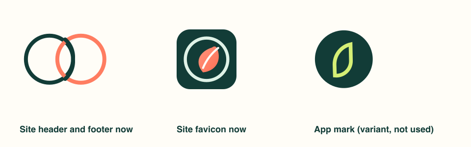

# Logo: the site's mark and the app's mark differ

- **Site header and footer now:** `project/src/components/TetherLogo.astro`,
  two interlocking rings (teal and coral). Its own comment says it is
  site-original and should be replaced if a corporate mark is approved. The
  social preview image `project/public/og-image.png` uses the same rings.
- **Site favicon now:** `project/public/favicon.svg`, the coral BreatheFree leaf
  in a ring on a teal square, the same drawing as
  `project/src/components/Logo.astro` (used on the home page and the
  BreatheFree page).
- **App design:** a lime leaf outline on a dark-green circle, shown beside the
  name "Tether Health" in the app header (owner artwork: the app's welcome
  screen design).
- **Prepared, not used:** `project/src/components/TetherAppLogo.astro` draws
  the app mark: the app's teal `#123C37` circle and lime `#D5EF75` leaf, with
  the wordmark "Tether Health". The leaf is traced from the owner's artwork
  because the design has no vector file for it.

Nothing on the site has been switched. If the owner chooses the app mark,
the change is: import `TetherAppLogo` in `Header.astro` and `Footer.astro`,
decide whether the favicon and `og-image.png` follow, and update
`project/test/functional/logo-variant.test.js`.
